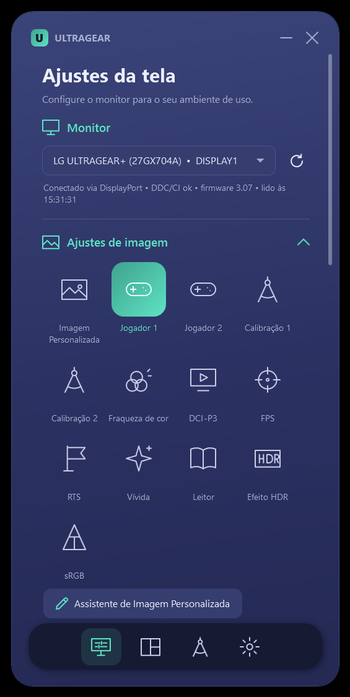
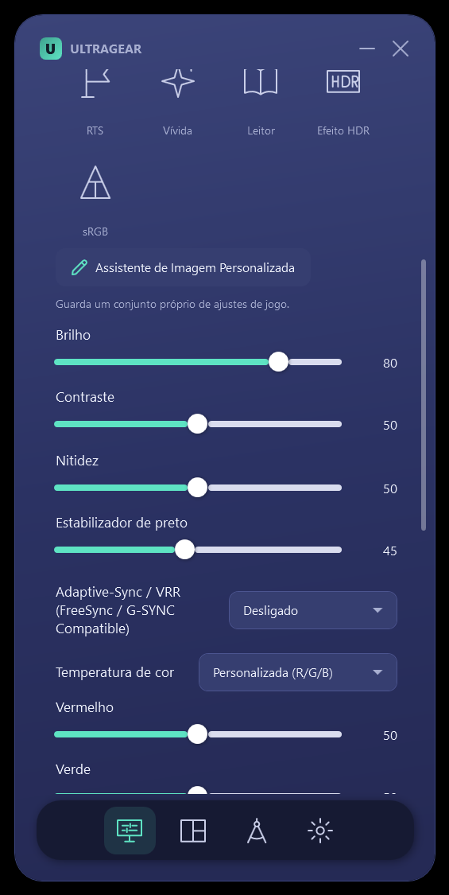
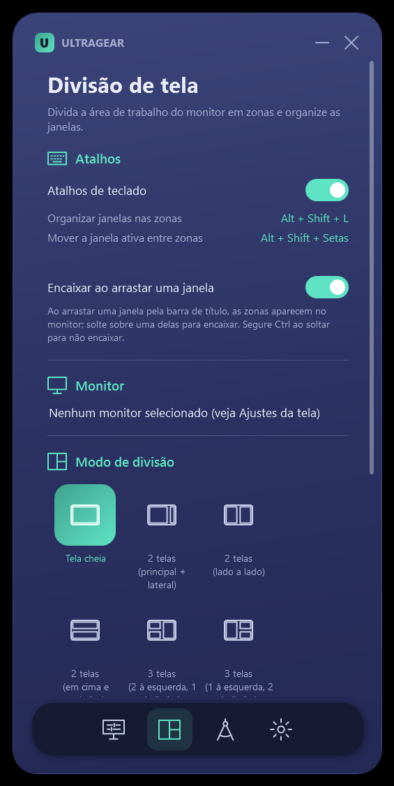

# Ultragear

**Controle independente do monitor LG 27GX704A (OLED) pelo Windows, via DDC/CI.**
Modos de imagem, brilho, contraste, cor, Adaptive-Sync/VRR, economia de energia, troca de modo por aplicativo, divisão de tela, perfis, perfis ICC e padrões de teste, num app leve e de arquivo único. É uma alternativa às funções úteis do LG Switch e do LG Calibration Studio, sem as partes que não servem para este monitor.

[](https://github.com/patrickinnecco/ultragear/actions/workflows/build.yml)


<p align="center">
  
  
  
</p>

## Download
Baixe o `Ultragear.exe` na página de **[Releases](https://github.com/patrickinnecco/ultragear/releases/latest)**. É um executável único e autocontido: não precisa instalar o .NET nem ser administrador.

## Funções
| Área | O que faz |
|---|---|
| **Modos de imagem** | 13 modos: Imagem Personalizada, Jogador 1/2, FPS, RTS, Vívida, Leitor, Efeito HDR, sRGB, DCI-P3, Fraqueza de cor, Calibração 1/2. O LG Switch mostra só 8 neste modelo. |
| **Imagem** | Brilho, contraste, nitidez, estabilizador de preto, temperatura de cor (Quente/Médio/Frio/R-G-B/Kelvin manual), Adaptive-Sync/VRR, SMART ENERGY SAVING |
| **Som** | Volume e "sem som" da saída de fones do monitor |
| **Windows** | Orientação da tela (com reversão automática), modo de imagem por aplicativo, perfis salvos, bandeja do sistema, iniciar com o Windows |
| **Assistente** | Assistente de Imagem Personalizada em 5 passos, ajustando o monitor ao vivo |
| **Divisão de tela** | 10 layouts + personalizado, encaixe ao arrastar janelas, atalhos `Alt+Shift+L` e `Alt+Shift+Setas` |
| **Calibração e cor** | Detecção de colorímetro, ativação de Calibração 1/2, perfil ICC só deste monitor, padrões de teste em tela cheia (rampa de cinza, preto, branco, gama, cores) |
| **Diagnóstico** | Firmware, nº de série, tempo de uso, modo de vídeo, HDR, capacidades DDC/CI, logs, autotestes |

Toda escrita é **conferida por leitura no monitor**. Se o monitor recusar um valor (por exemplo, um ajuste bloqueado no modo atual), o app avisa em vez de fingir que mudou. O app também relê o monitor a cada 10 s, então mudanças feitas pelo joystick aparecem na tela.

## Requisitos
- Windows 10 2004+ ou Windows 11, 64 bits.
- LG 27GX704A ligado, como tela ativa, conectado por DisplayPort ou HDMI direto na placa de vídeo. Hubs ou docks podem bloquear o DDC/CI.
- **Um controlador por vez:** feche o LG Switch, porque a "My Display Preset" dele troca o modo de imagem sozinha.
- O colorímetro é opcional e serve só para a calibração por hardware, que continua sendo feita no LG Calibration Studio.

## Testes automáticos
Com o app fechado:
```
Ultragear.exe --selftest            # todas as funções DDC/CI, com leitura e restauração (adicione --vrr para incluir o VRR)
Ultragear.exe --selftest-windows    # divisão de tela, modo por aplicativo, perfil ICC (com reversão)
Ultragear.exe --vcp get 15,10,12    # leitura de códigos VCP do LG (diagnóstico)
```
Relatórios em `%APPDATA%\Ultragear\`. Resultados no monitor real: [`docs/relatorios-de-teste`](docs/relatorios-de-teste): 45/45 e 9/9.

## Compilar a partir do código
```
cd source
dotnet publish -c Release -o ..\publish
```
Precisa do .NET SDK 7 ou mais recente no Windows. O GitHub Actions compila a cada push e anexa o `.exe` às releases criadas por tags `v*`.

## Como funciona
O app usa apenas APIs públicas do Windows:
- a *Monitor Configuration API* (`dxva2.dll`, padrão VESA DDC/CI-MCCS) para conversar com o monitor;
- `user32`/CCD para telas, orientação e janelas;
- WCS (`mscms.dll`) para perfis ICC.

O 27GX704A devolve a string de capacidades com checksum inválido. Por isso o app usa um **mapa de comandos medido no próprio monitor**, documentado em [`docs/ANALISE.md`](docs/ANALISE.md) junto com:
- o que foi reproduzido do LG Switch e do LG Calibration Studio;
- o que exige hardware;
- o que não é possível pelo PC, e por quê.

Estrutura do código: `source/Core` (DDC/CI, estado, autotestes), `source/Features` (recursos do Windows), `source/UI` (WPF), `source/Native` (P/Invoke).

## Linux
O app é para Windows (WPF + `dxva2`). Os mesmos comandos funcionam no Linux com o [`ddcutil`](https://www.ddcutil.com/). Veja [`docs/LINUX.md`](docs/LINUX.md) para o mapa de comandos pronto para usar.

## Aviso
Projeto pessoal e independente, **não afiliado à LG Electronics**. "LG", "UltraGear" e nomes de produtos são marcas dos respectivos donos. Nenhum código, biblioteca, imagem ou recurso dos aplicativos da LG foi copiado; os ícones e as imagens de referência foram criados para este projeto. Use por sua conta e risco.

## Licença
[MIT](LICENSE)
